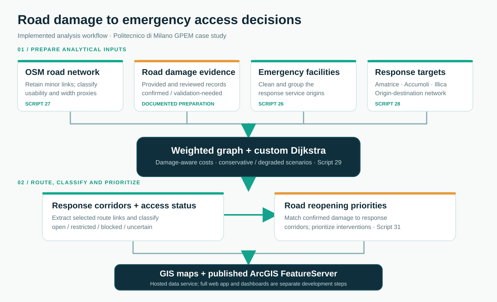

# Earthquake Emergency Road Accessibility

[](https://github.com/amirshokri17/seismic-emergency-road-accessibility/actions/workflows/python-checks.yml)

**Python/ArcPy automation · Damage-aware Dijkstra routing · Road reopening prioritization**

A curated technical portfolio from the team project **Geospatial Data Processing to Support Seismic Emergency Management** at Politecnico di Milano. The case study uses the **30 October 2016 Central Italy earthquake** to examine emergency road access around **Amatrice, Accumoli and Illica**.

> **Academic geospatial decision-support prototype, not an operational routing or road-safety tool.** This public repository contains five **publication-safe adaptations of original project scripts**. Machine-specific configuration and the default output-deletion policy were changed; the graph, Dijkstra, damage and priority algorithms were not rewritten. Original GIS input data are not included.

## Technical portfolio presentation

**[View the 10-slide PDF — GIS automation, custom Dijkstra and reopening priorities](docs/GPEM_Emergency_Road_Accessibility_Portfolio.pdf)**. It contains selected maps from the updated academic report and two legible workflow diagrams. The full 46-page group report is intentionally not published here.

## The problem

After a damaging earthquake, a mapped road network alone cannot indicate whether emergency services can reach affected settlements. Road debris, landslides, reduced passage width, uncertain observations and local-road connectivity complicate route choice.

We investigated how to translate road-damage evidence into **emergency accessibility assessments**, then identify **which damaged sections of selected response corridors warrant reopening attention**.

## Workflow



[View the full-size architecture diagram](assets/workflow-architecture.svg). The input preparation stage, routing algorithm and published outputs are intentionally separated to make the technical dependencies clear.

The original project included additional preprocessing and an exploratory image-screening stage. Those experimental scripts are **not part of this curated technical repository**; see [Architecture](docs/architecture.md).

## Engineering decisions worth highlighting

**1. Keep road-network connectivity.** An early filtering approach discarded too many minor OSM roads. The revised preparation preserved local links and classified emergency usability, width sources and network roles instead of removing roads for cartographic simplicity.

**2. Use a transparent routing model.** A custom graph and **Dijkstra's algorithm** were implemented in Python instead of building a full travel-time/traffic model from incomplete road and turn-restriction data. Each eligible edge has a length-based cost adjusted for damage and uncertain observations.

**3. Distinguish conservative access from a degraded scenario.** Confirmed high-severity roads can be excluded for conservative routing and assigned an extreme penalty for a degraded comparison. A degraded path is **not** proof that a blocked road is passable.

**4. Connect routes to decisions.** The analysis classifies response corridors, estimated road usability and confirmed damaged sections, then assigns relative reopening priority. This is decision-support, not engineering certification of safety.

## Dijkstra implementation

The published [routing script](scripts/29_emergency_service_accessibility_analysis.py) uses:

```text
edge_cost = road_segment_length × damage_or_uncertainty_multiplier
```

| Road condition | Treatment |
| --- | --- |
| No identified damage | ×1 |
| Confirmed Class 1 | ×1.5 |
| Confirmed Class 2 | ×5 |
| Confirmed Class 3 | Excluded in conservative routing; ×100 in degraded routing |
| Validation-needed only | ×2 |

Emergency vehicle-usability flags affect edge eligibility. Road width contributes to **subsequent route/corridor access classification**, **not** an independent continuous multiplier in `edge_cost()`. This is an important distinction from a more general formula in the academic report. See [Routing method](docs/routing-method.md).

## Selected scripts

| Script | Technical role |
| --- | --- |
| [26 — Emergency facility cleaning](scripts/26_clean_emergency_service_centers.py) | Clean/classify OSM service facilities and produce QA records |
| [27 — Complete OSM road preparation](scripts/27_clean_roads_ideal_osm_v2.py) | Preserve local road links, standardize type, width proxy and emergency usability |
| [28 — Response targets](scripts/28_create_emergency_response_targets.py) | Build target points used for service-to-settlement access |
| **[29 — Dijkstra-based accessibility](scripts/29_emergency_service_accessibility_analysis.py)** | **Build graph, assign penalties, route, classify corridors and target access** |
| [31 — Reopening priority](scripts/31_update_road_reopening_priority_from_corridors.py) | Rebuild ranked damaged-section layer using selected emergency corridors |

Published files are **not byte-for-byte copies** of their original project versions. Changes are itemized in [Source changes](docs/source-changes.md); the original analytical methods remain intact.

## Installation and execution boundaries

Scripts require **Windows, ArcGIS Pro/ArcPy and the original geodatabase schema**. They are not a one-command standalone pipeline. To configure your own authorized project, set `GPEM_MAIN_GDB`, `GPEM_APRX_PATH`, and optionally `GPEM_QA_DIR` and `GPEM_ROADS_SERVICE_URL`.

`GPEM_CLEAR_OUTPUT=false` is the safer default for final outputs; other ArcPy operations may still modify GIS state, so **use a disposable workspace**.

- [Configuration and safety](docs/configuration.md)
- [Input/output data contract](docs/data-contract.md)
- [Environment notes](docs/environment.md)
- [Known limitations](docs/limitations.md)

## Verification

The five published scripts pass Python syntax/compilation checks. A small dependency-free [test suite](tests/) exercises the **actual Dijkstra core extracted from Script 29** (without importing ArcPy) and checks that personal Windows paths and the original hosted-service URL are absent.

```bash
python -m compileall -q scripts tests
python -m unittest discover -s tests -v
```

The full ArcPy/GIS workflow, route counts and mapped results cannot be independently reproduced without the project datasets and environment. These tests should **not** be interpreted as geospatial or operational validation.

## Published ArcGIS data service and portfolio

**[GPEM_ROAD_MANAGEMENT — ArcGIS FeatureServer](https://services7.arcgis.com/XOvkSqDDbi6QLE5s/arcgis/rest/services/GPEM_ROAD_MANAGEMENT/FeatureServer)** is the published **geospatial data-service endpoint** documented in Section 14.3 of the updated academic report (46 pages). The report organizes its layers into:

| Published group | Project outputs |
| --- | --- |
| Base network and context | OSM Road Network, Emergency Service Centers, Emergency Response Targets |
| Road damage and uncertainty | Ground Truth, damaged sections, confirmed acquired damage and validation-needed sections |
| Emergency accessibility | Emergency Response Corridor Network, Emergency Target Accessibility Status |
| Early recovery | Emergency Road Reopening Priority, with supporting spatial layers |

The URL is a **FeatureServer REST service**, *not* a finished end-user web dashboard. The report describes web-map configuration, dashboard development and mobile field validation as **implementation steps**, not features already demonstrated here. Service content and anonymous accessibility should be tested directly by prospective users; live verification was unavailable in the review environment.

The updated **46-page group report remains unpublished** in this repository. Instead, a focused **[10-slide portfolio PDF](docs/GPEM_Emergency_Road_Accessibility_Portfolio.pdf)** is published, using selected source maps from pages 23, 37 and 41 and a clearer two-stage workflow diagram. For context, Part I of the report also covers Norcia seismic vulnerability and damage scenarios and 25 municipalities; the curated repository emphasizes the stronger Part II automation, Dijkstra and reopening strategies.

For WebGIS status, implementation boundaries and source-layer groups, read [Published service notes](docs/webgis-and-report.md).

## Team and attribution

The academic report credits **Amirhossein Shokri, Nima Khamsehzadeh, Sildev Kumar Ray and MohammadReza Abolhasani**. This repository does not infer individual authorship of every script. No open-source license has been chosen pending rights review. Consult the [publication checklist](PUBLICATION_CHECKLIST.md) before reuse or wider promotion.
