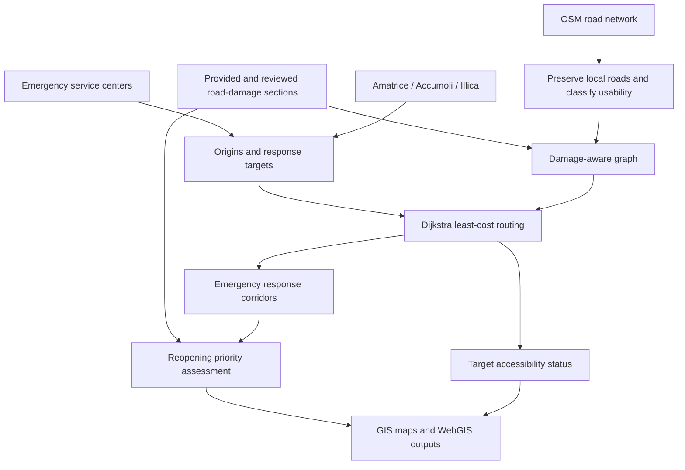

# Earthquake Emergency Road Accessibility

**Geospatial automation · Damage-aware Dijkstra routing · Emergency road-reopening priorities**

A curated technical portfolio from the group project *Geospatial Data Processing to Support Seismic Emergency Management* at Politecnico di Milano, using the **2016 Central Italy earthquake** as a case study. The emergency-response destinations are **Amatrice, Accumoli, and Illica**.

> **Repository preparation in progress.** This public repository currently contains the architecture and publication documentation. The original source files are intentionally held back until contributor permissions and repository visibility are confirmed. This is not a deployed emergency response tool.

## Engineering question

How can geospatial data and observed road disruptions be translated into a decision-support view of emergency accessibility and the road sections that deserve reopening attention?

## Workflow

## Three emphasized engineering decisions

1. **Preserve network connectivity.** An early road-cleaning approach over-filtered minor road types. The revised OSM workflow retained local roads and characterized their emergency suitability instead of discarding them.
2. **Implement custom graph routing.** Roads were transformed into connected graph edges. The routing code applies Dijkstra's algorithm with length-based costs modified by road-damage severity and uncertainty; it also supports conservative and degraded-route scenarios.
3. **Prioritize damage on response corridors.** Selected emergency routes were linked to verified damage and estimated road usability to classify reopening priorities.

## Original scripts selected for eventual publication

| Original file | Main responsibility |
| --- | --- |
| `26_clean_emergency_service_centers.py` | Prepare emergency-service origins |
| `27_clean_roads_ideal_osm_v2.py` | Prepare OSM roads, classes, usability and width proxies |
| `28_create_emergency_response_targets.py` | Create response targets |
| `29_emergency_service_accessibility_analysis.py` | Construct graph, run Dijkstra and classify route/corridor access |
| `31_update_road_reopening_priority_from_corridors.py` | Classify damaged response-corridor sections for reopening |

**These scripts are not yet committed to this public repository.** Once published, their original logic and contents will be preserved without silent modification. The experimental ML-training code is outside the scope of this technical showcase.

## Technical documentation

- [Architecture](docs/architecture.md)
- [Actual Dijkstra model and limitations](docs/routing-method.md)
- [Publication checklist](PUBLICATION_CHECKLIST.md)

## Scientific and operational boundaries

This project is an academic **decision-support demonstration**, not a validated operational dispatch system. Original analyses depend on ArcGIS Pro/ArcPy, project-specific geodatabases, width proxies and road-damage assumptions. No current road condition or safe passage is guaranteed.

The routing script's numerical edge cost does **not** implement independent width and road-type multipliers. Those factors are considered in network eligibility and subsequent access interpretation; see the detailed method notes.

## Report, WebGIS and attribution

The 42-page group report includes earlier vulnerability and damage scenarios for Norcia and 25 municipalities, alongside the emergency road-management study. A public report copy and verified WebGIS URL will be linked when permission and access are confirmed.

Report contributors: **Amirhossein Shokri, Nima Khamsehzadeh, Sildev Kumar Ray, and MohammadReza Abolhasani**. Individual responsibilities are not assigned here without supporting evidence. No source-code license is asserted while rights are being reviewed.
